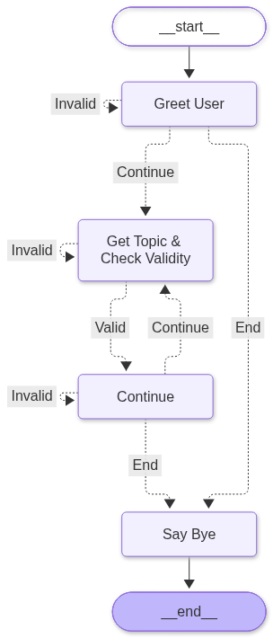

# AI Joke Bot


[](LICENSE)

[](https://colab.research.google.com/github/vjabarca/AI-Agent-Joke-Bot/blob/main/AI_Joke_Bot.ipynb)

An interactive, command-line joke bot built as a [LangGraph](https://langchain-ai.github.io/langgraph/) state machine. A comedian-persona agent greets you, asks what kind of joke you want, uses an LLM to check that the topic is valid and tell a joke about it, and keeps going until you say you're done.

## Table of Contents

- [Overview](#overview)
- [Workflow](#workflow)
- [Example Session](#example-session)
- [Tech Stack](#tech-stack)
- [Installation](#installation)
- [Configuration](#configuration)
- [Usage](#usage)
- [How It Works](#how-it-works)
- [Project Structure](#project-structure)
- [Known Issues & Limitations](#known-issues--limitations)
- [Roadmap](#roadmap)
- [Contributing](#contributing)
- [License](#license)
- [Author & Support](#author--support)

## Overview

Most simple chatbots are one long prompt, so they can drift off-topic or loop on bad input. This project shows a more controlled pattern: the conversation is a **graph** with explicit nodes (greet, get topic, continue, say goodbye) and **routers** that decide the next step from the user's answer. The LLM handles the creative parts (greeting, topic validation, writing the joke), while ordinary Python code controls the flow, including re-prompting when the input is invalid.

## Workflow



| Node | What it does |
|---|---|
| **Greet User** | The LLM, in a comedian persona, asks whether you want a joke and tells you to answer yes or no. |
| **Get Topic & Check Validity** | Asks for a joke type, then the LLM returns JSON saying whether the topic is valid and, if so, a joke about it. |
| **Continue** | Asks whether you want another joke. |
| **Say Bye** | Prints a goodbye and ends the run. |

Routing rules:

- **After the greeting:** `yes` goes to topic selection, `no` goes to goodbye, anything else repeats the greeting.
- **After the topic check:** a valid topic goes to "Continue", an invalid one asks for the topic again.
- **After "Continue":** `yes` goes back to topic selection, `no` goes to goodbye, anything else repeats the question.

The shared state passed between nodes is a small `TypedDict`:

```python
class AgentState(TypedDict):
    topic: str
    topic_validity: str
    response: str
```

## Example Session

An actual run from the notebook (user input shown after each prompt):

```text
Hey! Want to hear a joke? Just hit me with a yes or no!
> xxxx
Hey, hey! Wanna hear a joke? Just hit me with a "yes" or "no."
> yes
what type of Joke are you in the mood for?
> xxxx
Please enter a valid topic
what type of Joke are you in the mood for?
> Cooking
Why did the chef break up with the calendar? Because their days were numbered in the kitchen!
Do you want another joke? Reply yes or no
> yes
what type of Joke are you in the mood for?
> Travel
Why don't scientists trust atoms when they travel? Because they make up everything!
Do you want another joke? Reply yes or no
> no
Goodbye!
```

Note how the bot rejects the nonsense input (`xxxx`) both at the greeting and at the topic prompt, and re-asks instead of failing.

## Tech Stack

- **Language:** Python 3
- **Orchestration:** [LangGraph](https://github.com/langchain-ai/langgraph) (`StateGraph`, conditional edges)
- **LLM:** OpenAI `gpt-4.1-mini` through the official `openai` client, with JSON-mode output for topic validation
- **Environment:** Jupyter / Google Colab

## Installation

### Option A: Google Colab (as the notebook was written)

1. Click the **Open In Colab** badge above, or upload `AI_Joke_Bot.ipynb` to [Google Colab](https://colab.research.google.com/).
2. Add your OpenAI key as a Colab secret (see [Configuration](#configuration)).
3. Run the cells top to bottom. The install cells set up all dependencies.

### Option B: Run locally

```bash
# 1. Clone the repository
git clone https://github.com/vjabarca/AI-Agent-Joke-Bot.git
cd AI-Agent-Joke-Bot

# 2. Create and activate a virtual environment
python -m venv .venv
source .venv/bin/activate        # Windows: .venv\Scripts\activate

# 3. Install dependencies
pip install openai langgraph langchain-openai langchain-community "requests>=2.32.5" jupyter

# 4. Launch the notebook
jupyter notebook AI_Joke_Bot.ipynb
```

> **Local runs:** the first notebook cell reads the key with `google.colab.userdata`, which only exists in Colab. Replace that cell with the environment-variable setup shown below.

## Configuration

One API key is required.

| Variable | Used for | Where to get it |
|---|---|---|
| `OPENAI_API_KEY` | Greeting, topic validation, and joke generation | [platform.openai.com](https://platform.openai.com/api-keys) |

**In Colab**, create a secret named `ai_agents_openai` (the key icon in the left sidebar) and enable notebook access. The notebook reads it with:

```python
from google.colab import userdata
os.environ["OPENAI_API_KEY"] = userdata.get("ai_agents_openai")
```

**Locally**, export it in your shell:

```bash
export OPENAI_API_KEY="sk-..."
```

Never commit API keys to the repository.

## Usage

1. Run the setup cells (API key, installs, imports, client).
2. Run the cells that define the state, the node functions, the routers, and the workflow.
3. Optionally render the graph:

   ```python
   display(Image(app.get_graph().draw_mermaid_png()))
   ```

4. Start the bot:

   ```python
   result = app.invoke({})
   ```

5. Chat in the notebook's input box. Answer `yes` or `no` to the yes/no questions and type any joke topic (for example `cooking`, `travel`, `ice cream`) when asked.

## How It Works

1. `greet_user` asks the LLM to greet you as a comedian and ask for a yes/no answer, then stores your reply in `state["response"]`.
2. `response_router` lowercases that reply and returns `Continue`, `End`, or `Invalid`, and the graph follows the matching edge.
3. `get_topic` asks for a topic and sends it to the LLM with instructions to return JSON: `{"valid": "yes", "response": "<joke>"}` or `{"valid": "no", "response": "Please enter a valid topic"}`. The joke is printed and the validity flag is stored in the state.
4. `topic_router` sends valid topics to `continuation` and invalid ones back to `get_topic`.
5. `continuation` asks if you want another joke and reuses `response_router` to loop or finish.
6. `goodbye` prints a farewell and the graph reaches `END`.

## Project Structure

```text
.
├── AI_Joke_Bot.ipynb            # the full bot: nodes, routers, and workflow
├── docs/
│   └── joke_bot_workflow.png    # rendered LangGraph workflow diagram
├── LICENSE
└── README.md
```

## Known Issues & Limitations

- **Colab-specific setup:** the API key cell uses Colab secrets, so local use needs a small change.
- **Topic validation is LLM-judged:** the model decides what counts as a "valid" joke type, so borderline topics may be accepted or rejected inconsistently.
- **Fragile JSON handling:** if the model returns malformed JSON, the code prints a warning but then reads a variable that was never set, which raises an error instead of re-asking.
- **Exact-match yes/no:** the routers only accept exactly `yes` or `no` (case-insensitive). Replies like `yeah` or `no thanks` are treated as invalid.
- **Recursion limit:** LangGraph stops a run after its default number of steps. A long session, or many invalid inputs in a row, can raise `GraphRecursionError`. The `recursion_limit` setting is not configured yet.
- **No memory of past jokes:** the bot does not track what it already told you, so jokes can repeat.
- **Unused imports:** a few imports in the notebook (for example `ChatPromptTemplate`, `ChatOpenAI`, `OpenAIEmbeddings`, `ast`) are not used yet.
- **Graph rendering needs internet:** `draw_mermaid_png()` renders through an online service.

## Roadmap

- [ ] Handle malformed JSON by re-prompting instead of crashing
- [ ] Accept natural yes/no replies (`yeah`, `nope`, `sure`) with an LLM or keyword intent check
- [ ] Raise the recursion limit and catch `GraphRecursionError` with a friendly message
- [ ] Remember past jokes in the state to avoid repeats
- [ ] Let users rate jokes and adapt the next one
- [ ] Add a `requirements.txt` with pinned versions
- [ ] Make the bot runnable as a local script and add a simple web UI

## Contributing

Contributions, bug reports, and feature ideas are welcome.

1. **Report a bug or request a feature:** open an [issue](https://github.com/vjabarca/AI-Agent-Joke-Bot/issues) and include what you expected, what happened, and your environment (Colab or local).
2. **Submit a change:**
   1. Fork the repository
   2. Create a branch: `git checkout -b feature/your-feature`
   3. Commit your changes with a clear message
   4. Push the branch and open a pull request describing what changed and why

Please clear notebook outputs and make sure no API keys appear in the notebook before committing.

## License

Distributed under the MIT License. See [`LICENSE`](LICENSE) for details.

## Author & Support

**Victor J. Abarca**, San José, CA

- GitHub: [@vjabarca](https://github.com/vjabarca)

For questions or problems, please open an issue in this repository.

## Acknowledgments

- [LangGraph](https://github.com/langchain-ai/langgraph) for the state-machine framework
- [OpenAI](https://openai.com/) for the language model
